# Отчёт по заключительному проекту

## 1. Цель

Создано desktop-приложение на Python с двумя вкладками: HTTP-клиент и HTTP-сервер. HTTP реализован поверх TCP-сокетов без `requests`, `urllib3`, `aiohttp`, `httpx`, Flask, FastAPI и `http.server`.

## 2. Архитектура

Слои проекта:

- HTTP: `Url`, `Request`, `Response`, `Parser`, `Serializer`, `HttpParser`, `HttpSerializer`;
- сеть: `Socket`, `TcpClient`, `TcpServer`;
- клиент: `HttpClient`, `HttpError`;
- сервер: `HttpServer`, `Router`, handlers, `GuiQueueLogHandler`;
- GUI: `App`, `ClientTab`, `ServerTab`, `HeaderTable`, `LogTable`.

В проекте 21 класс и два ABC-интерфейса. Диаграмма: `architecture.puml`, скриншот S13.

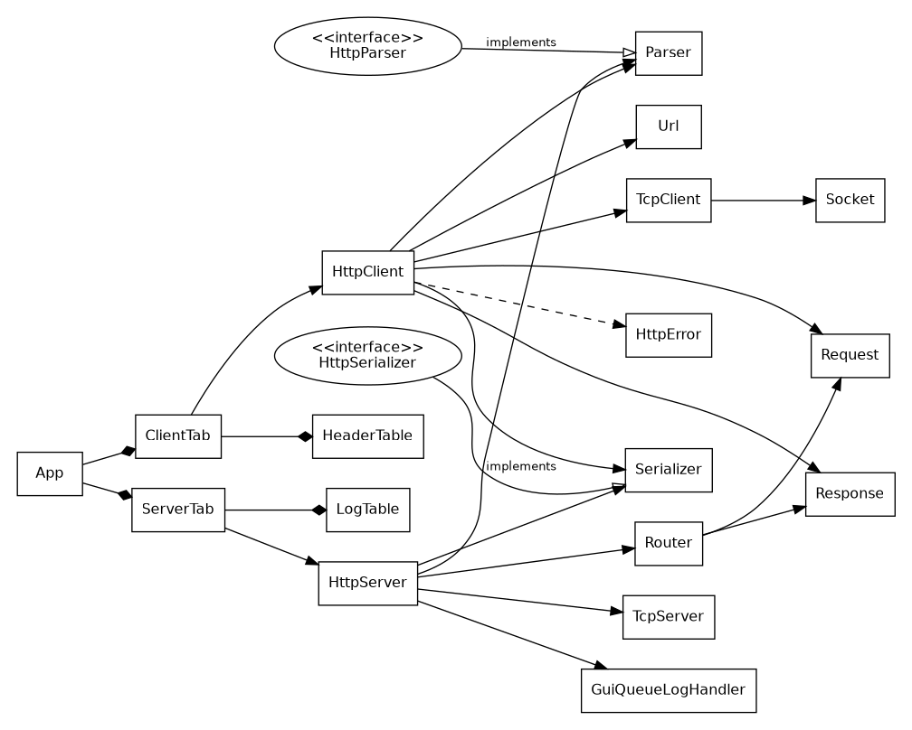

## 3. HTTP-клиент

Реализованы GET/POST, пользовательские заголовки, тело, `set_timeout(ms)`, URL parsing, Content-Length, chunked responses и HTTPS через `ssl`. Сокет клиента обёрнут в context manager. Сетевые ошибки преобразуются в `ConnectionError`/`TimeoutError`, ошибки формата — в `ParseError`. `HttpError(status)` используется методом `raise_for_status()` и при превышении redirect limit. Бонусный `follow_redirects(max)` поддерживает 301/302/303/307/308.

GUI не выполняет сетевые операции в Tk main thread: виджеты читаются в главном
потоке, фоновые потоки выполняют запросы и запуск/остановку сервера, а результаты
возвращаются через `queue.Queue` и обрабатываются `after()`.

## 4. HTTP-сервер

Поддерживаются:

- `GET /` -> HTML Hello;
- `POST /echo` -> точное эхо body и исходного Content-Type;
- `GET /time` -> текущее UTC-время в JSON;
- `GET /headers` -> request headers в JSON;
- `GET /status/{code}` -> заданный HTTP status;
- остальные маршруты -> 404.

Некорректный запрос -> 400 без падения процесса. Каждый ответ сериализуется со status line, Content-Type, Content-Length и Date. Реализованы HTTP/1.0/1.1 правила close/keep-alive. Сервер accept-loop работает в отдельном потоке и создаёт worker thread на соединение. Stop выполняется через `Event` + закрытие listening socket, а не kill.

Лог запроса содержит время, метод, путь, статус и миллисекунды. Одна и та же структурированная запись проходит через `logging.Handler` в GUI и через logging hierarchy в файл.

## 5. GUI

Вкладка клиента содержит URL, GET/POST, таблицу заголовков Add/Delete, POST body, Send/Clear, статус и response area. Поле body отключено для GET. Во время worker-запроса показывается `Отправка...`.

Подсветка не декоративная, а реальная через Text tags:

- 2xx — зелёный;
- 3xx — жёлто-коричневый;
- 4xx/5xx и исключения — красный;
- HTTP header names — отдельный цвет;
- JSON keys/strings/numbers/literals — разные цвета;
- HTML tags/attributes/string values — разные цвета.

Response read-only и имеет обе полосы прокрутки.

Вкладка сервера содержит порт, Start/Stop, green/red indicator, текст состояния, лог-таблицу, Clear log и Open in browser. Поле порта и кнопки меняют state согласно состоянию сервера.

## 6. Тестирование

Финальный автоматический прогон: **79 passed**.

Покрыты U1-U10 и I1-I10 из задания. I10 дополнен проверкой, что после 1000 запросов worker threads сервера завершены. Дополнительно протестированы redirects, HttpError, full-client chunked parsing, timeout setter, `/time`, `/headers`, port release и oversized response headers.

Stress: 100 параллельных GET -> 100/100 status 200.

`python -X dev -m pytest -q`: 79 PASS. `flake8`: 0 ошибок. `pylint`:
10.00/10. `compileall`: PASS.

## 7. Скриншоты

### S1 — GET http://example.com

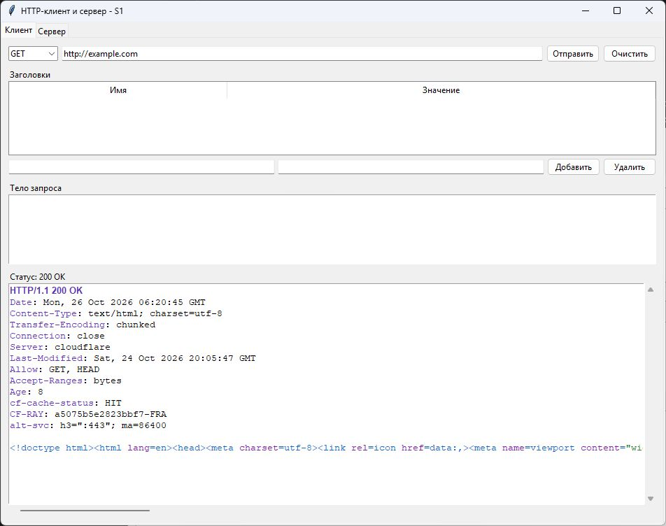

### S2 — POST /echo

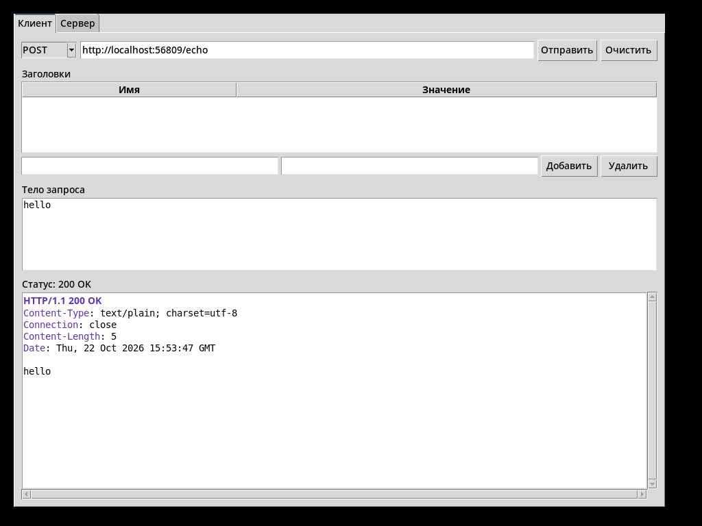

### S3 — неверный URL

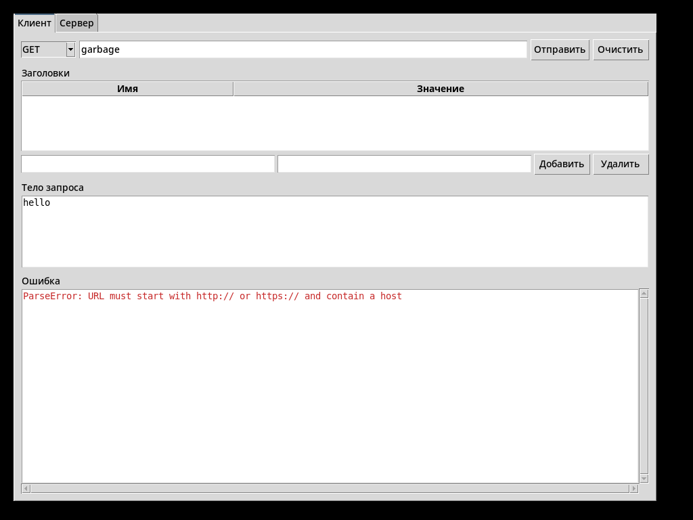

### S4 — сервер запущен на 8080

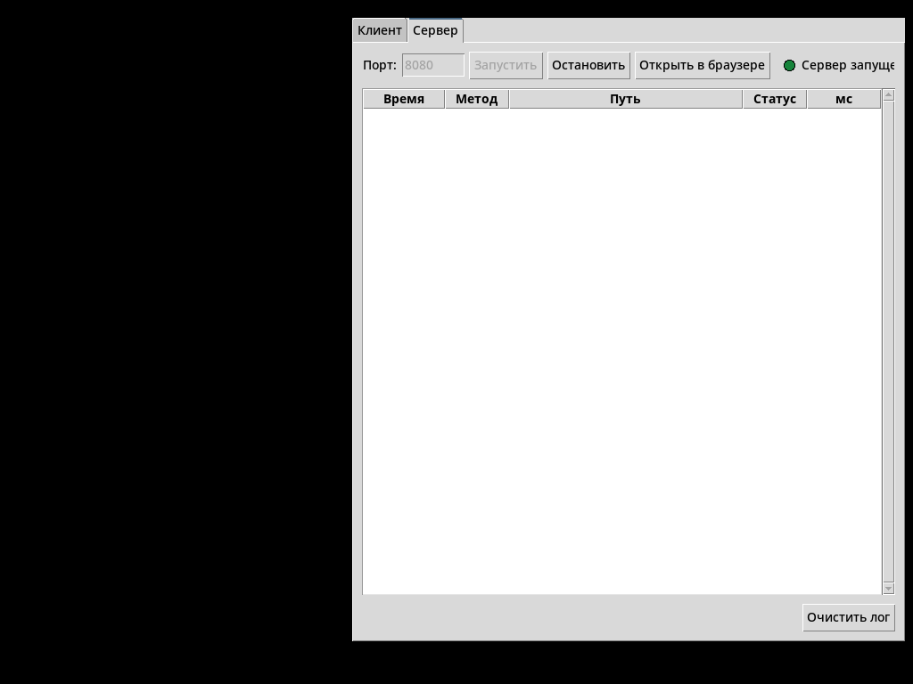

### S5 — curl GET + обновление GUI-лога

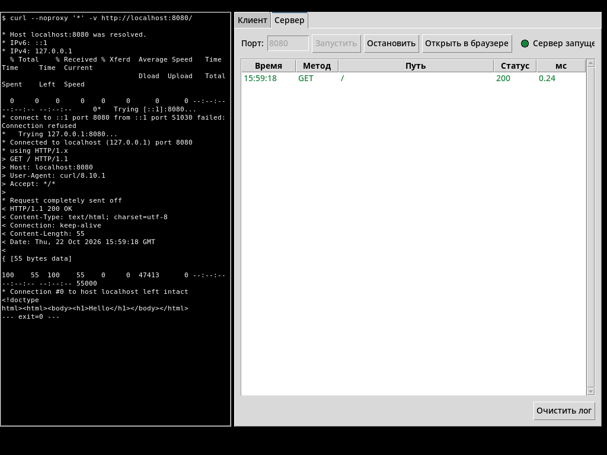

### S6 — curl POST /echo

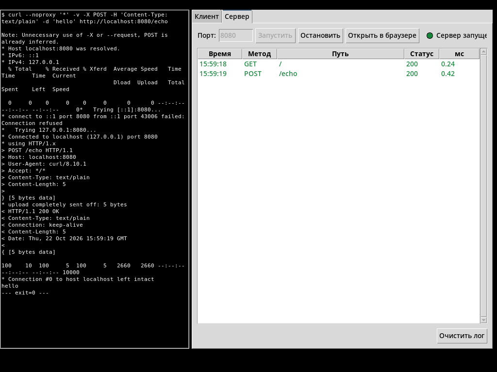

### S7 — status 418

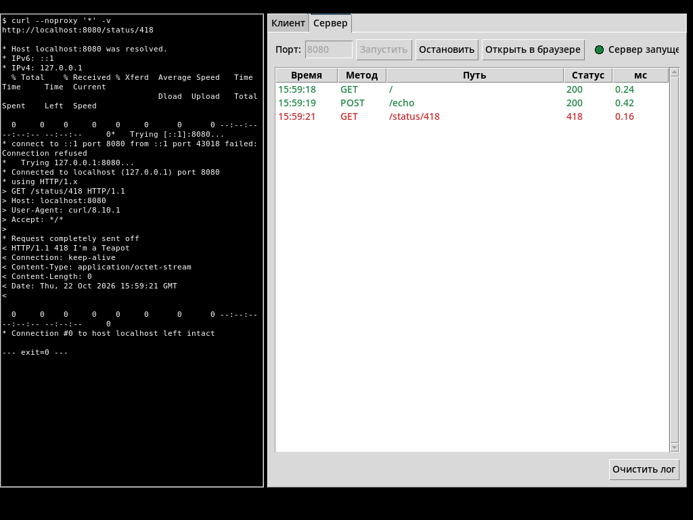

### S8 — 404

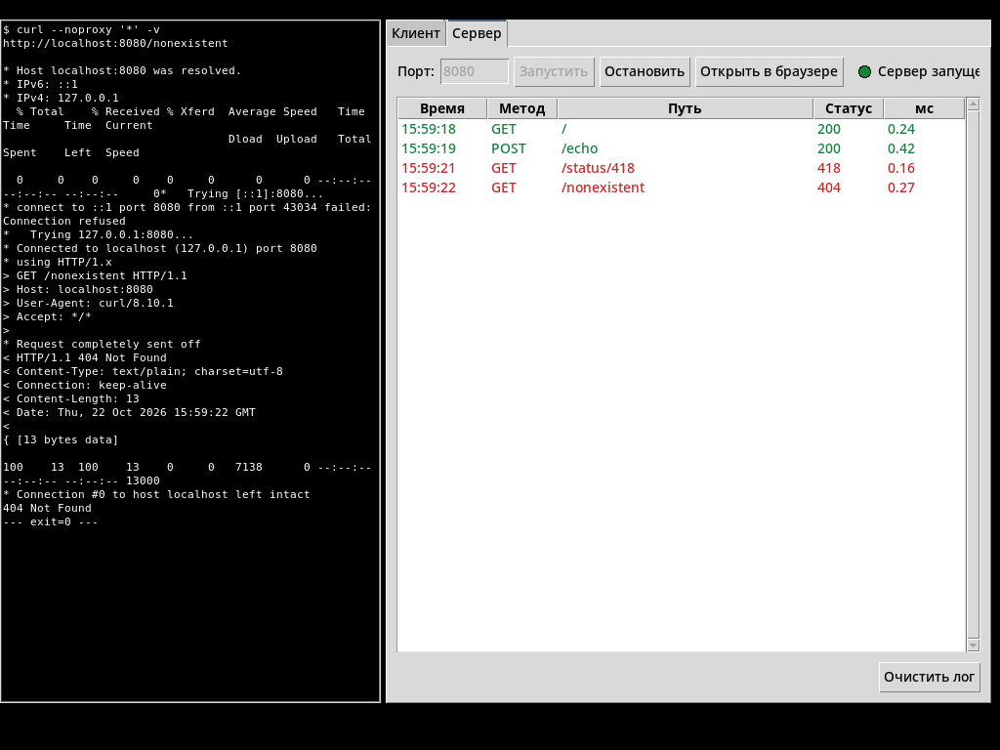

### S9 — лог с множеством запросов

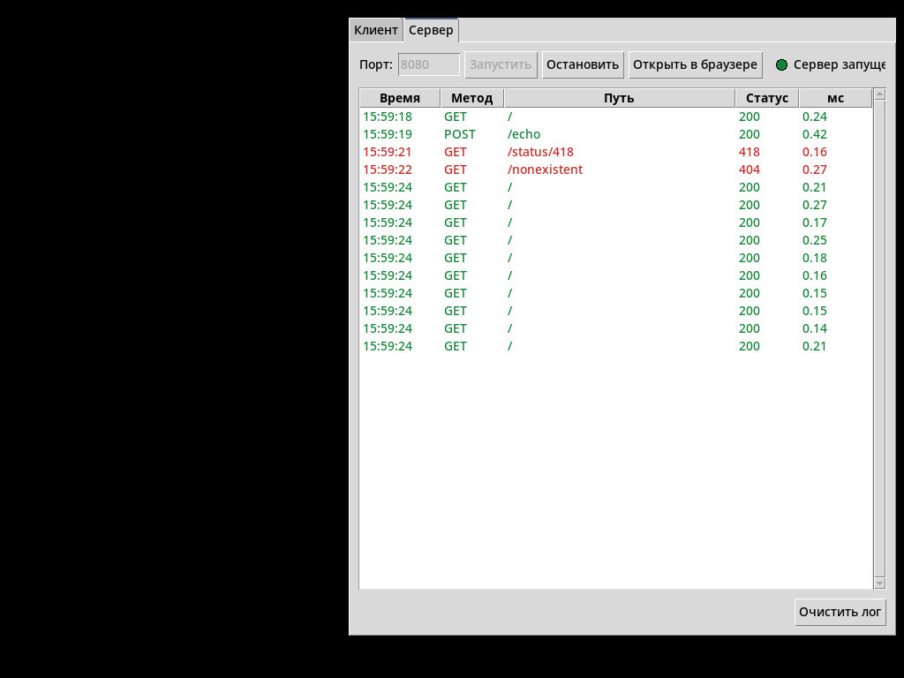

### S10 — pytest PASS

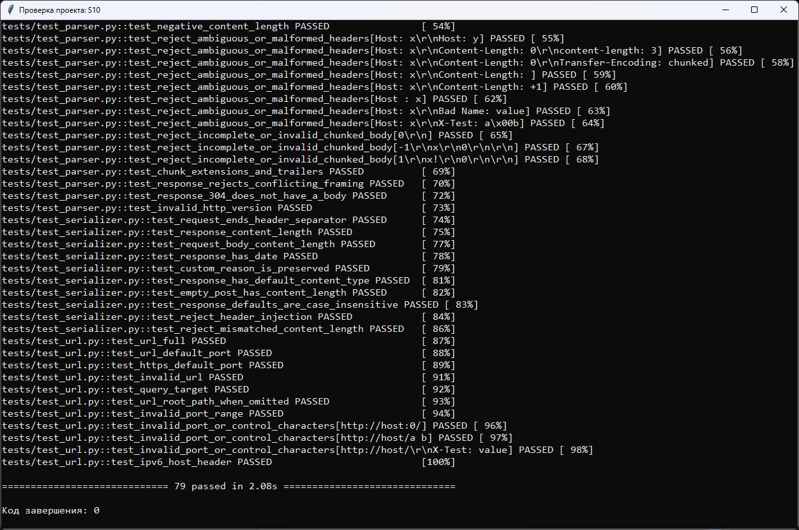

### S11 — flake8 PASS

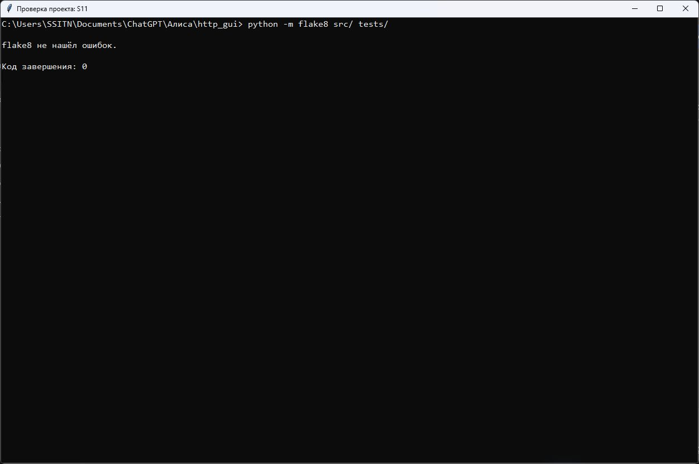

### S12 — 100 параллельных запросов

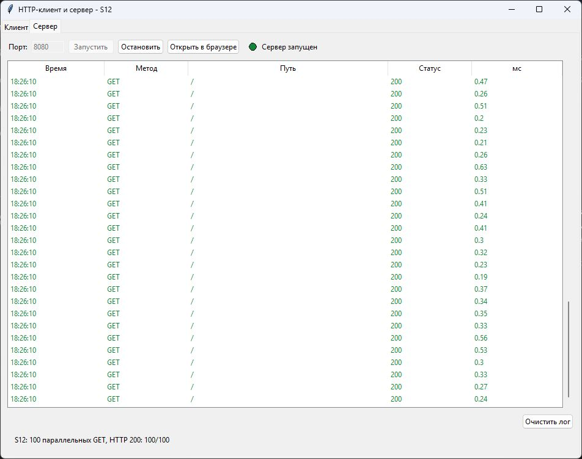

S11 показывает фактический запуск `flake8 src/ tests/`: ошибок нет, код
завершения 0. `pylint src/` также выполнен отдельно: 10.00/10.

## 8. Анализ многопоточности и безопасности

Tkinter обслуживается только main thread. Worker клиента не обращается к widgets. Сервер защищает набор worker threads через Lock, а GUI-передача логов основана на thread-safe Queue.

Защита HTTP parsing включает 8 KiB limit headers, 10 MiB server body limit, проверку Content-Length, отказ от неоднозначной пары Transfer-Encoding + Content-Length, отказ от unsupported chunked request bodies и отсутствие преобразования URL path в filesystem path.

